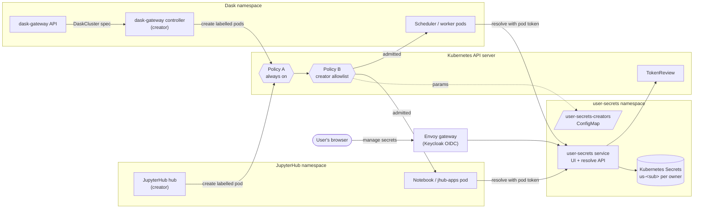
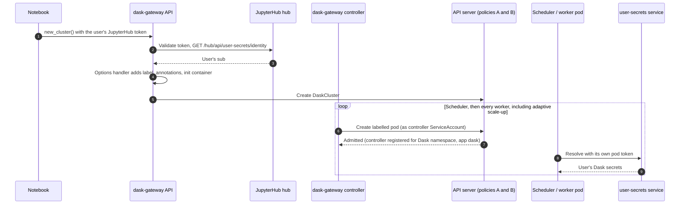
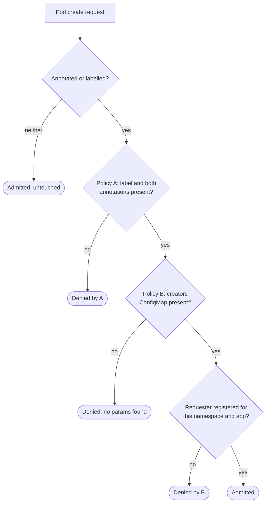
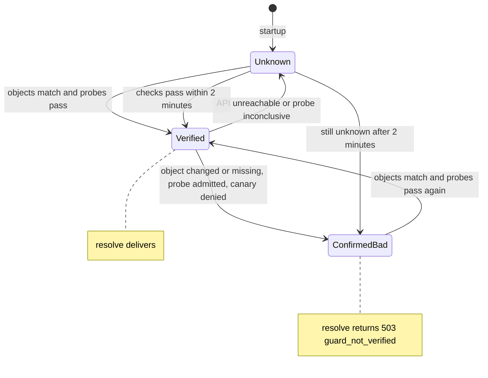
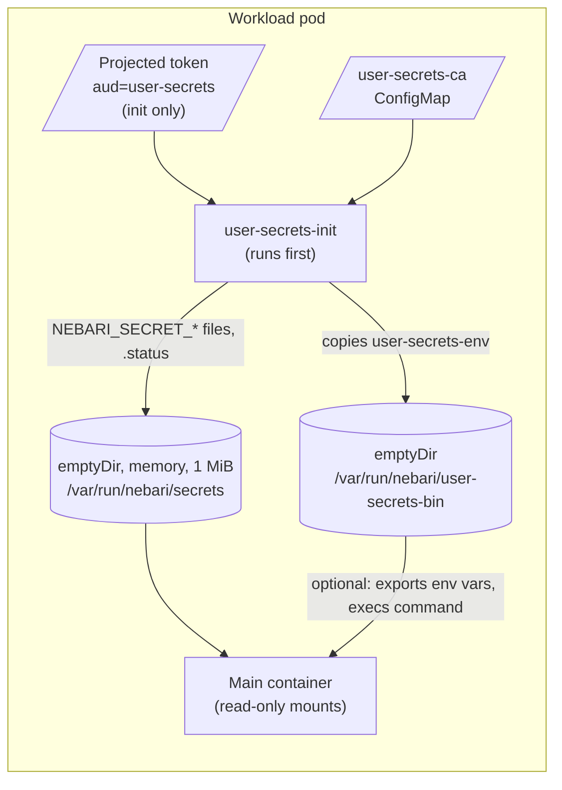

# Design: per-user secrets for Nebari workloads

| | |
|---|---|
| **Status** | Proposed, open for feedback |
| **Date** | 2026-11-10 |
| **Primary repo** | `nebari-dev/nebari-user-secrets` (new) |
| **Deployed by** | NIC, as foundational software (ADR-0022, proposed in [nebari-dev/nebari-infrastructure-core#764](https://github.com/nebari-dev/nebari-infrastructure-core/pull/764)) |
| **Reference consumers** | `nebari-dev/data-science-pack` (JupyterHub, jhub-apps), `nebari-dev/dask-gateway-pack` (Dask) |
| **Supersedes** | `nebari-dev/external-auth-pack` (experimental) |
| **Detailed spec** | [`docs/design/user-secrets-spec.md`](user-secrets-spec.md) (types, signatures, layout, test seams, journeys) |

## Summary

Nebari users get one place to store their own API keys and similar secrets, tied to their Keycloak identity. The secrets they enable for an app arrive as files in that app's pods at start: notebook servers, jhub-apps apps and Dask clusters in the first release. Each pod proves which pod it is with a token the Kubernetes API server issues. Which user the pod belongs to is stamped on the pod by the component that already authenticated that user (the JupyterHub hub, the dask-gateway controller). Two admission policies in the API server make sure only those components can stamp it and that nobody can change it afterwards. The service fails closed when it cannot confirm those policies are in force.

## Problem

A data scientist with a vendor token, an OpenAI key or a fine-grained GitHub PAT pastes it into a notebook cell or a `.env` file in their home directory today. It is visible in notebooks they share, it lives on persistent storage, and it never reaches the Dask clusters they launch. Nebari has no way to hold a secret for a user and hand it only to that user's workloads.

The hard part is not storing secrets. It is knowing, inside the cluster, which user a given pod belongs to, in a way another user cannot forge, including for Dask workers that start long after the user logged in.

## Goals

- A user stores, rotates and deletes their own secrets in a web UI reachable from the Nebari landing page.
- A user chooses per secret which apps receive it and the suffix of its name; every delivered name is `NEBARI_SECRET_<SUFFIX>`.
- Notebooks, jhub-apps apps and Dask clusters (scheduler and every worker, including adaptive scale-up) receive the enabled secrets at pod start as files under `/var/run/nebari/secrets/`, and optionally as environment variables.
- A pod's user identity comes only from a creator registered for that namespace and app, enforced by the API server; the service refuses to deliver when it cannot confirm that.
- A user can see per app when secrets were last delivered and why the last attempt failed.
- Every value read is audited.
- The service is independent of any software pack: any pack can become a consumer by meeting a written contract, with values-only registration.
- Backward compatible: NIC installs the component on every cluster, but that changes no existing workload; every software pack's integration is off by default.

## Non-goals (first release)

- Sharing secrets between users (the data model keeps this open).
- A credential-injecting proxy ("use without seeing").
- Live update of running pods; a rotation reaches pods started afterwards.
- Background workloads with no user present. This is a goal for later, through service (bot) accounts.
- New Dask clusters after the user's Keycloak session has ended (the hub already rejects them today); existing clusters keep scaling.

## Threat model

The design protects secrets from **other users**. Platform admins may see values, since they can read the store's Kubernetes Secrets and exec into pods. For the first release, JupyterHub admins are also accepted as able to see values, because their role can open and share any server.

**Sharing a server shares what that server can reach.** A user who shares a notebook server shares its secret files and environment, including the owner's JupyterHub token, with which a sharee can start Dask clusters as the owner and read the owner's Dask secrets. The UI says so next to sharing and every Dask binding; narrowing this is a follow-up.

## Architecture



Three things must hold before the service returns any value:

| Check | How | Why it cannot be forged |
|---|---|---|
| Which pod | TokenReview on the pod's projected ServiceAccount token (audience `user-secrets`) returns the pod name and UID; the service reads the pod and requires the UID to match | The API server signs the token and binds it to one pod; only kubelets may mint this audience |
| Which app | The `nebari.dev/user-secrets-app` annotation names a registered app, and the pod runs as that app's registered ServiceAccount in a registered namespace | A notebook pod cannot claim to be Dask |
| Which user | The `nebari.dev/user-secrets-sub` annotation on a pod carrying the label `nebari.dev/user-secrets: "true"` | Only a creator registered for that namespace and app can create such a pod, and nothing can change the label or annotations afterwards |

### Notebook spawn

```mermaid
sequenceDiagram
    autonumber
    participant B as Browser
    participant H as JupyterHub hub
    participant K as API server (policies A and B)
    participant I as user-secrets-init (in pod)
    participant S as user-secrets service
    participant M as Main container
    B->>H: Start server
    H->>H: modify_pod_hook: label, annotations (sub, app),<br/>init container, volumes, projected token
    H->>K: Create pod (as hub ServiceAccount)
    K-->>H: Admitted (creator registered for namespace and app)
    K->>I: Pod scheduled, kubelet mints user-secrets token
    I->>S: POST /api/v1/resolve (Bearer pod token, TLS)
    S->>K: TokenReview, GET pod
    S->>S: UID, label, annotations, registry, guard state
    S-->>I: Secrets for this user and app
    I->>I: Write /var/run/nebari/secrets/NEBARI_SECRET_*
    I->>M: Exit; main container starts
    M->>M: Optional wrapper exports files as env vars, then execs
```

### Dask cluster creation and scale-up



Each Dask pod proves itself when it starts, so workers added hours later get their secrets with no Keycloak session involved.

## Pod identity and the admission guard

Kubernetes lets anyone who can create pods in a namespace use any ServiceAccount or Secret in it. Any in-namespace identity is therefore only as strong as the control over who can create or change pods that carry it. That control is two ValidatingAdmissionPolicies.

| Policy | Matches | Rules |
|---|---|---|
| **A, `user-secrets-pod-guard`** (no parameters, always on) | Pod create and update including subresources; ServiceAccount token requests | An annotated pod must carry the label, and a labelled pod both annotations. The label and annotations are immutable, including through `pods/status`. A labelled pod's spec is immutable. No ephemeral containers on labelled pods. No user-secrets metadata on Bindings. Only kubelets mint `user-secrets` tokens. The service's own account may create pods only as dry-run probes. |
| **B, `user-secrets-creators`** (parameters, labelled pods only) | Creation of labelled pods | The requester is a registered creator, the namespace is one of its namespaces, and the app is one of its apps. Parameters come from the `user-secrets-creators` ConfigMap. |



**Why two policies.** Kubernetes fetches a binding's parameters before it evaluates anything. With `parameterNotFoundAction: Deny`, a missing ConfigMap would deny every request the binding matches, across the whole cluster; with `Allow`, it would skip the binding's rules entirely and switch the guard off. Splitting the parameter-free rules into policy A, and selecting only labelled pods in policy B, means a missing ConfigMap denies only labelled pod creates while every other rule stays in force.

**Fail closed.** Each service replica watches both policies, both bindings and the ConfigMap, compares them with what it expects, and every five minutes runs three dry-run probes: a labelled pod (must be denied by B), an unlabelled annotated pod (must be denied by A) and a plain canary (must be admitted).



**Pods admitted while the guard was off are never trusted later.** The service fingerprints the guard objects (`uid` and `generation` for the policies and bindings, `uid` and `resourceVersion` for the ConfigMap) and records `verifiedSince`, which only moves forward, in a ConfigMap all replicas watch. Any change, or a return to verified after a confirmed-bad state, moves it forward once the probes pass again, using the API server's time plus a 30-second margin. Resolve refuses pods created before it. This closes the window during a `[Warn]` rollout, before the policies are installed, or while a binding is edited.

**Override.** A deployment that cannot install the policies can set `guard.mode: unverified`. Delivery then relies on the deployer's statement that only the registered creators can create or patch pods in the consumer namespaces; every audit line and an admin banner say so.

**Trust in creators.** A compromised hub could name any user in its namespace; it nearly can today, because it holds every logged-in user's refresh token. A compromised dask-gateway API or controller could reach any user's Dask secrets, but not other apps'. dask-gateway-pack ships its own small policy so that only the gateway API can write a `DaskCluster` carrying these annotations.

### What the Kubernetes team is asked to review

The cluster-scoped objects ship apart from the Helm chart, in `cluster/` with a `REVIEW.md`. Under the proposed ADR-0022, NIC applies them as part of the foundational install, after the chart (which creates the ConfigMap they read); teams that review cluster-scoped objects separately review this directory.

| Object | Evaluated on | Designed to deny only |
|---|---|---|
| Policy A + binding | Every pod create and update, every pod subresource write, every ServiceAccount token request (`failurePolicy: Fail`) | Requests carrying or gaining user-secrets metadata; `user-secrets` tokens requested by anything but a kubelet; real pod creates by the service's account |
| Policy B + binding | Labelled pod creates | Labelled pods from unregistered creators, namespaces or apps; all labelled pods while the ConfigMap is missing |
| `ClusterRoleBinding` to `system:auth-delegator` | n/a | Lets the service create TokenReviews |
| `ClusterRole` + binding, read-only | n/a | `get`, `list`, `watch` on the two policies and two bindings |

Preconditions: Kubernetes 1.30 or later, and the NodeRestriction admission plugin. Rollout: bindings at `[Warn, Audit]` first to observe, then `[Deny]`; delivery starts for pods created after that.

## Delivery



- **Files, not environment variables, are the contract.** One file per secret, exact bytes, mode `0440`, group-readable through the pod's `fsGroup`. A memory volume dies with the pod, so values never reach etcd beyond the owner record and nothing needs cleaning up.
- **Environment variables are optional.** A pack prepends `user-secrets-env` to its container's arguments; it exports each file as a variable and executes the real command.
- **Names are always `NEBARI_SECRET_<SUFFIX>`.** A user-chosen variable name such as `LD_PRELOAD` or `PYTHONSTARTUP` could turn a secret into code execution, and no denylist is complete; a fixed prefix closes the class.
- **Failures are visible.** `.status` in the pod, a stderr warning from the wrapper, and the last delivery per app in the UI. Consumers choose `soft` (start without secrets, the default) or `strict` (block the pod).
- **Transport.** In-cluster TLS. cert-manager issues a self-signed CA inside the service namespace; each consumer chart creates an empty `user-secrets-ca` ConfigMap that the service fills.

## Consumer contract

Any pack that wants a user's secrets in its workloads:

1. Opts in (`userSecrets.enabled: false` by default; when off, its rendered chart and pods are unchanged, checked against golden files).
2. Registers its app, workload ServiceAccount and creator in nebari-user-secrets's values; the service and the cluster bundle do not change.
3. Uses the single-file, standard-library-only Python helper, vendored into its chart, to build pod settings, and applies them at the last point before pod creation.
4. Runs workload pods as the registered ServiceAccount (an existing one is kept, not replaced).
5. Labels and annotates each pod, taking the user's `sub` only from a source it authenticated itself.
6. Never lets user input choose the ServiceAccount, labels, annotations, init containers, volumes or command wrapper.
7. Adds the init container, the two volumes, the projected token, the CA ConfigMap and an `fsGroup`.
8. Allows egress to the service.
9. Never copies values anywhere else: no environment literals in pod specs, no Kubernetes Secrets, no custom resource fields, no logs.
10. Chooses a failure mode.
11. Never delivers to code the user did not choose to run.

**data-science-pack** applies the settings in a KubeSpawner `modify_pod_hook`, which runs after profile overrides and after jhub-apps sets its command, and adds a small hub endpoint that returns a token owner's `sub` for dask-gateway. **dask-gateway-pack** subclasses the JupyterHub authenticator to fetch the `sub`, and wraps the cluster options handler to add the settings to scheduler and worker pods.

## Alternatives considered

| Alternative | Verdict | Why |
|---|---|---|
| ServiceAccount per user | Rejected | Same trust as the annotation (any pod creator can use any ServiceAccount in its namespace), plus a lifecycle to manage |
| Namespace per user | Rejected | Strongest boundary, but some deployments get a single namespace |
| Per-user namespaces as an option | Rejected for now | Doubles the test matrix; each consumer would need a namespace-per-user mode |
| Keycloak token in the pod | Rejected | Access tokens expire; a refresh token in a user pod is too powerful |
| Pull from inside the pod with the user's hub token | Rejected | Any code or sharee in the pod could fetch everything; Dask workers have no hub token; ties the service to JupyterHub |
| Mutating webhook that sets environment variables | Rejected | Values land in pod specs readable by the `view` role; an unavailable webhook blocks pod creation |
| Vault or External Secrets Operator | Rejected | Identity keyed on ServiceAccount or namespace brings back per-user ServiceAccounts; External Secrets creates per-workload Secrets |
| Secrets Store CSI driver | Rejected | Same ServiceAccount-keyed identity |
| Extending Javo's secret store | Not chosen | The hard part is pod identity and delivery, which is the same whichever store holds records; Javo can become a consumer |
| One `.env` file | Rejected | Dotenv has no common escaping standard, so it cannot carry arbitrary bytes |
| A single admission policy | Rejected | A missing ConfigMap either blocks the whole cluster or switches the guard off |
| Creator-signed assertions | Deferred | Useful where the policies cannot be installed, but replayable and weaker than the policies |

## Testing

The admission policies have a case matrix (`test/policy/run.sh`) that runs against throwaway kind clusters on Kubernetes 1.30, 1.32 and 1.34, the minimum supported version and the versions NIC deploys. It covers every rule of both policies, the behaviour with the ConfigMap missing, `[Warn]` admission, kubelet-minted projected tokens and the TokenReview fields the service relies on, and it builds the bundle for a non-default namespace. Current transcripts are in `test/policy/results/`.

## Open questions

1. How Argo CD is kept from reverting the service-filled data of each consumer's `user-secrets-ca` ConfigMap under NIC's Argo CD settings.
2. The pod-manifest golden-file harnesses for data-science-pack and dask-gateway-pack, which neither repo has today.
3. `fsGroup` behaviour of `emptyDir` volumes with the init container's user, and the built binary's size.
4. That cert-manager's namespaced CA chain works at NIC's pinned cert-manager version.
5. Smaller verifications listed in the detailed spec (jhub-apps spawner detection, token `azp`, custom-scope enforcement, dask-gateway option fields).

## Future work

- Sharing secrets with other users and groups (the data model already separates owner and grants).
- Service (bot) accounts for background workloads.
- Live refresh of running pods with the same pod-bound token.
- Narrowing what a shared server exposes to sharees.
- Application-level encryption of stored values.
- A signed-assertion fallback and a Go helper, if needed.
