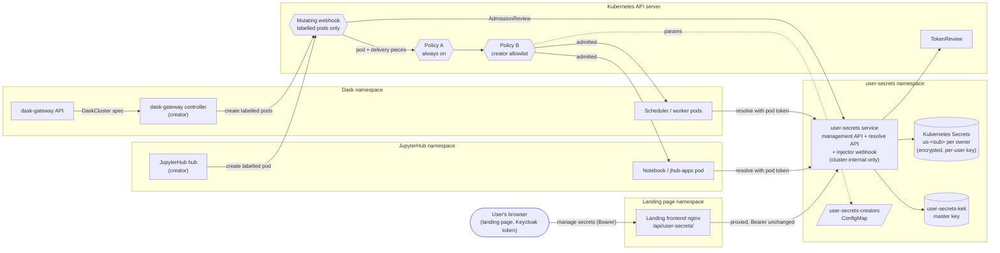
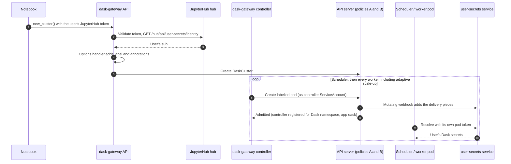
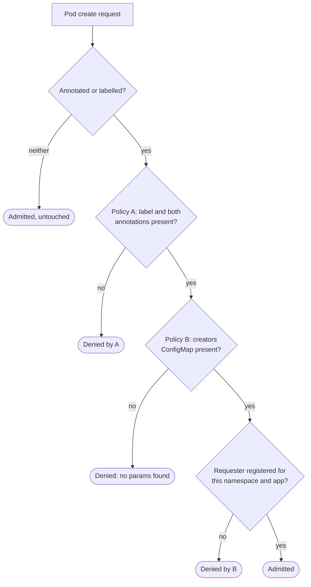
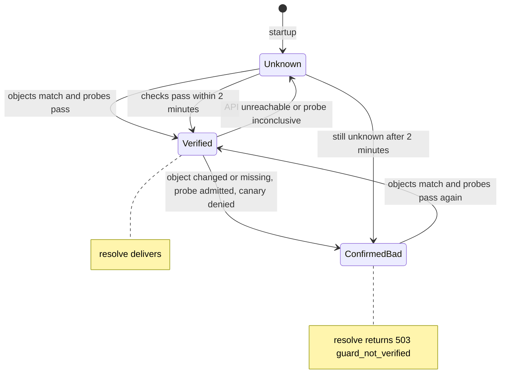
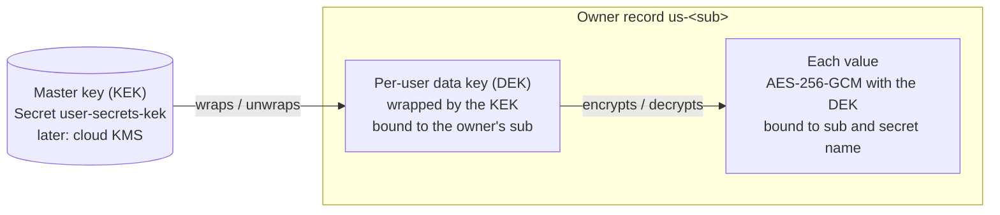
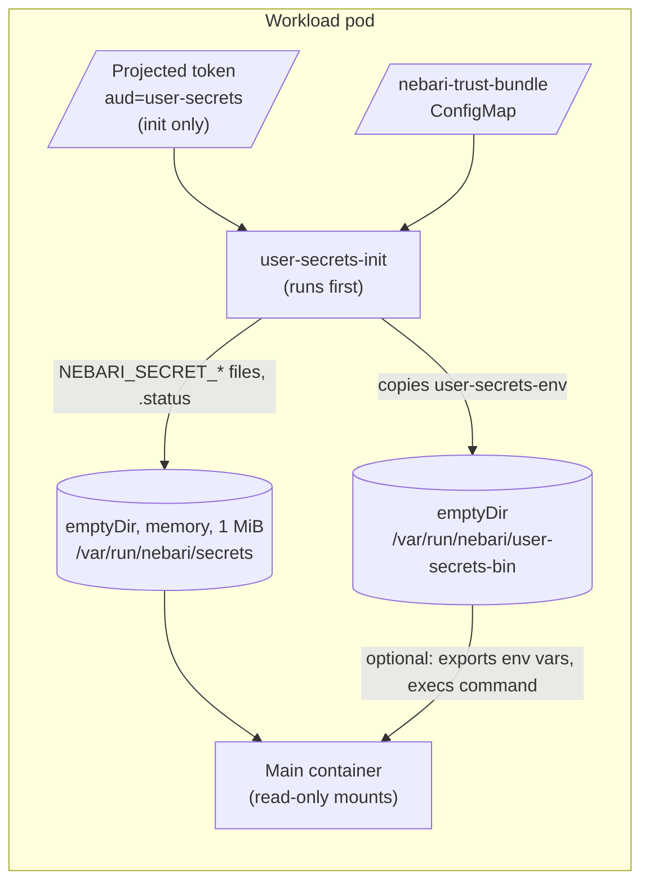

# Design: per-user secrets for Nebari workloads

| | |
|---|---|
| **Status** | Proposed, open for feedback |
| **Date** | 2026-11-10, revised 2026-11-20 |
| **Primary repo** | `nebari-dev/nebari-user-secrets` (new) |
| **Deployed by** | NIC, as foundational software (ADR-0022, proposed in [nebari-dev/nebari-infrastructure-core#764](https://github.com/nebari-dev/nebari-infrastructure-core/pull/764)) |
| **Reference consumers** | `nebari-dev/data-science-pack` (JupyterHub, jhub-apps), `nebari-dev/dask-gateway-pack` (Dask) |
| **Secrets screens** | The Nebari landing page, through this service's management API ([nebari-dev/nebari-landing#236](https://github.com/nebari-dev/nebari-landing/issues/236)) |
| **Requires** | NIC's always-on cluster CA and trust bundle (`nebari-ca-issuer`, `nebari-trust-bundle`), from [nebari-dev/nebari-infrastructure-core#787](https://github.com/nebari-dev/nebari-infrastructure-core/pull/787) (merged 2026-11-23, on top of #776) |
| **Supersedes** | `nebari-dev/external-auth-pack` (experimental) |
| **Detailed spec** | [`docs/design/user-secrets-spec.md`](user-secrets-spec.md) (types, signatures, layout, test seams, journeys) |

## Summary

Nebari users get one place to store their own API keys and similar secrets, tied to their Keycloak identity and encrypted with a key per user. The secrets they enable for an app arrive as files in that app's pods at start: notebook servers, jhub-apps apps and Dask clusters in the first release. Each pod proves which pod it is with a token the Kubernetes API server issues. Which user the pod belongs to is stamped on the pod by the component that already authenticated that user (the JupyterHub hub, the dask-gateway controller). Two admission policies in the API server make sure only those components can stamp it and that nobody can change it afterwards. A mutating webhook adds everything else delivery needs, so a pack only sets a label and two annotations. The service fails closed when it cannot confirm those policies are in force.

## Problem

A data scientist with a vendor token, an OpenAI key or a fine-grained GitHub PAT pastes it into a notebook cell or a `.env` file in their home directory today. It is visible in notebooks they share, it lives on persistent storage, and it never reaches the Dask clusters they launch. Nebari has no way to hold a secret for a user and hand it only to that user's workloads.

The hard part is not storing secrets. It is knowing, inside the cluster, which user a given pod belongs to, in a way another user cannot forge, including for Dask workers that start long after the user logged in.

## Goals

- A user stores, rotates and deletes their own secrets from the Nebari landing page, which calls this service's management API ([nebari-dev/nebari-landing#236](https://github.com/nebari-dev/nebari-landing/issues/236)).
- A user chooses per secret which apps receive it and the suffix of its name; every delivered name is `NEBARI_SECRET_<SUFFIX>`.
- Notebooks, jhub-apps apps and Dask clusters (scheduler and every worker, including adaptive scale-up) receive the enabled secrets at pod start as files under `/var/run/nebari/secrets/`, and optionally as environment variables.
- A pod's user identity comes only from a creator registered for that namespace and app, enforced by the API server; the service refuses to deliver when it cannot confirm that.
- A user can see per app when secrets were last delivered and why the last attempt failed.
- Stored values are encrypted with a key per user, wrapped by a master key the operator can rotate.
- Every value read is audited.
- The service is independent of any software pack: any pack can become a consumer by meeting a written contract, with values-only registration and no code vendored from this repo.
- Backward compatible: NIC installs the component on every cluster, but that changes no existing workload; every software pack's integration is off by default.

## Non-goals (first release)

- A UI served by this service. The landing page provides the screens; a standalone UI may come later.
- Sharing secrets between users (the data model keeps this open).
- A credential-injecting proxy ("use without seeing").
- Live update of running pods; a rotation reaches pods started afterwards.
- Background workloads with no user present. This is a goal for later, through service (bot) accounts.
- New Dask clusters after the user's Keycloak session has ended (the hub already rejects them today); existing clusters keep scaling.

## Threat model

The design protects secrets from **other users**. Platform admins may see values, since they can read the master key and the store's Kubernetes Secrets, and exec into pods. Encryption keeps values out of anything that holds the owner records without the master key, such as an export or backup of the records, and lets a deleted user's values be destroyed by deleting their key. For the first release, JupyterHub admins are also accepted as able to see values, because their role can open and share any server.

**Sharing a server shares what that server can reach.** A user who shares a notebook server shares its secret files and environment, including the owner's JupyterHub token, with which a sharee can start Dask clusters as the owner and read the owner's Dask secrets. The landing page says so next to every Dask binding, and data-science-pack's share dialog says so next to sharing; narrowing this is a follow-up.

**The landing page is inside the trust boundary for managing secrets.** The token that can change a user's secrets lives in the landing page's JavaScript, and the landing frontend pods are the only thing allowed to reach the management API. A cross-site scripting bug in the landing page could use a signed-in user's token to overwrite, rebind or delete that user's secrets. It could not read them, because the API never returns values, and it could not reach another user's secrets. A UI served by this service would carry the same exposure on its own origin; moving the screens to the landing page moves that exposure into nebari-landing's code, so its frontend security is part of this feature ([nebari-dev/nebari-landing#236](https://github.com/nebari-dev/nebari-landing/issues/236)).

**Whoever can get certificates from the cluster CA is trusted not to intercept the service.** The service's TLS certificate comes from NIC's `nebari-ca-issuer`, and clients trust it through `nebari-trust-bundle`. Anyone who can create a cert-manager `Certificate` in any namespace can get a certificate for the service's name (NIC's [internal certificates guide](https://github.com/nebari-dev/nebari-infrastructure-core/pull/787), "Who can issue"). Using one would also need a way to redirect traffic for the service's in-cluster name to a pod they control. With both, they could capture an init container's 10-minute resolve token and replay it once for that pod's secrets. A CA private to this service would close the first half; one cluster CA that every pack uses, without a CA ConfigMap that the service writes into every consumer namespace, is the trade we take. Pods with the user-secrets label carry their token only in the init container and present it once.

## Architecture



Three things must hold before the service returns any value:

| Check | How | Why it cannot be forged |
|---|---|---|
| Which pod | TokenReview on the pod's projected ServiceAccount token (audience `user-secrets`) returns the pod name and UID; the service reads the pod and requires the UID to match | The API server signs the token and binds it to one pod; only kubelets may mint this audience |
| Which app | The `nebari.dev/user-secrets-app` annotation names a registered app, and the pod runs as that app's registered ServiceAccount in a registered namespace | A notebook pod cannot claim to be Dask |
| Which user | The `nebari.dev/user-secrets-sub` annotation on a pod carrying the label `nebari.dev/user-secrets: "true"` | Only a creator registered for that namespace and app can create such a pod, and nothing can change the label or annotations afterwards |

### Notebook spawn

```mermaid
sequenceDiagram
    autonumber
    participant B as Browser
    participant H as JupyterHub hub
    participant K as API server (policies A and B)
    participant I as user-secrets-init (in pod)
    participant S as user-secrets service
    participant M as Main container
    B->>H: Start server
    H->>H: modify_pod_hook: label, annotations (sub, app)
    H->>K: Create pod (as hub ServiceAccount)
    K->>S: Mutating webhook (labelled pods only)
    S-->>K: Patch: init container, volumes, projected token, mounts
    K-->>H: Admitted by policies A and B (creator registered for namespace and app)
    K->>I: Pod scheduled, kubelet mints user-secrets token
    I->>S: POST /api/v1/resolve (Bearer pod token, TLS)
    S->>K: TokenReview, GET pod
    S->>S: UID, label, annotations, registry, guard state
    S-->>I: Secrets for this user and app
    I->>I: Write /var/run/nebari/secrets/NEBARI_SECRET_*
    I->>M: Exit; main container starts
    M->>M: Optional wrapper exports files as env vars, then execs
```

### Dask cluster creation and scale-up



Each Dask pod proves itself when it starts, so workers added hours later get their secrets with no Keycloak session involved.

## Pod identity and the admission guard

Kubernetes lets anyone who can create pods in a namespace use any ServiceAccount or Secret in it. Any in-namespace identity is therefore only as strong as the control over who can create or change pods that carry it. That control is two ValidatingAdmissionPolicies.

| Policy | Matches | Rules |
|---|---|---|
| **A, `user-secrets-pod-guard`** (no parameters, always on) | Pod create and update including subresources; ServiceAccount token requests | An annotated pod must carry the label, and a labelled pod both annotations. The label and annotations are immutable, including through `pods/status`. A labelled pod's spec is immutable. No ephemeral containers on labelled pods. No user-secrets metadata on Bindings. Only kubelets mint `user-secrets` tokens. The service's own account may create pods only as dry-run probes. |
| **B, `user-secrets-creators`** (parameters, labelled pods only) | Creation of labelled pods | The requester is a registered creator, the namespace is one of its namespaces, and the app is one of its apps. Parameters come from the `user-secrets-creators` ConfigMap. |



**Why two policies.** Kubernetes fetches a binding's parameters before it evaluates anything. With `parameterNotFoundAction: Deny`, a missing ConfigMap would deny every request the binding matches, across the whole cluster; with `Allow`, it would skip the binding's rules entirely and switch the guard off. Splitting the parameter-free rules into policy A, and selecting only labelled pods in policy B, means a missing ConfigMap denies only labelled pod creates while every other rule stays in force.

**Fail closed.** Each service replica watches both policies, both bindings and the ConfigMap, compares them with what it expects, and every five minutes runs three dry-run probes: a labelled pod (must be denied by B), an unlabelled annotated pod (must be denied by A) and a plain canary (must be admitted).



**Pods admitted while the guard was off are never trusted later.** The service fingerprints the guard objects (`uid` and `generation` for the policies and bindings, `uid` and `resourceVersion` for the ConfigMap) and records `verifiedSince`, which only moves forward, in a ConfigMap all replicas watch. Any change, or a return to verified after a confirmed-bad state, moves it forward once the probes pass again, using the API server's time plus a 30-second margin. Resolve refuses pods created before it. This closes the window during a `[Warn]` rollout, before the policies are installed, or while a binding is edited.

**Override.** A deployment that cannot install the policies can set `guard.mode: unverified`. Delivery then relies on the deployer's statement that only the registered creators can create or patch pods in the consumer namespaces; every audit line and an admin banner say so.

**Trust in creators.** A compromised hub could name any user in its namespace; it nearly can today, because it holds every logged-in user's refresh token. A compromised dask-gateway API or controller could reach any user's Dask secrets, but not other apps'. dask-gateway-pack ships its own small policy so that only the gateway API can write a `DaskCluster` carrying these annotations.

### The injector

A creator sets only who the pod is for. Everything else delivery needs is added by a mutating webhook the service serves, `user-secrets-injector`, so no pack vendors code from this repo or tracks its init image.

| | |
|---|---|
| **Matches** | Pod `CREATE` with the label `nebari.dev/user-secrets: "true"` (`objectSelector`). Every other pod is never sent to it. |
| **Adds** | The `user-secrets-init` init container (the image the service release pins), the memory volume for the files, the wrapper volume, the projected token (`audience: user-secrets`, 600 seconds) mounted only into the init container, the `nebari-trust-bundle` ConfigMap mounted only into the init container, read-only mounts of the files and the wrapper into the workload container, and an `fsGroup` when the pod has none. With the annotation `nebari.dev/user-secrets-export-env: "true"` it also prepends the wrapper to the workload container's `args`. |
| **Workload container** | The first container, which is the workload container in KubeSpawner and dask-gateway pods. A pack can name others with the annotation `nebari.dev/user-secrets-containers`. |
| **Never** | Denies a pod, sets a value, changes the ServiceAccount, labels or annotations. Denial is the policies' job: they run after every mutating webhook, so they check the finished pod. |
| **Side effects** | None, so dry-run requests, including the guard's probes, go through it. Idempotent, with `reinvocationPolicy: IfNeeded`, so a later webhook that adds containers gets the mounts too. |
| **TLS** | Serving certificate from `nebari-ca-issuer`; the API server's `caBundle` is filled by cert-manager's `cert-manager.io/inject-ca-from`. |

**When the webhook is unreachable, the pack's failure mode decides.** The configuration has two entries. Pods labelled `nebari.dev/user-secrets-failure: strict` go to the entry with `failurePolicy: Fail`, and are refused while the service is down. All other labelled pods go to the entry with `failurePolicy: Ignore` and start without the delivery pieces: no secret files, no wrapper and no `.status` file. A missing `.status` tells a user that injection failed, not delivery; admins see it in the API server's webhook metrics. This is the same choice a consumer makes for resolve failures (`soft` or `strict`), extended to injection.

Injection is not part of the guard. A missing or broken injector stops delivery, and the guard is about who receives secrets. The resolve checks are the same whether the init container came from the injector or was hand-built by a trusted creator.

### What the Kubernetes team is asked to review

The cluster-scoped objects ship apart from the Helm chart, in `cluster/` with a `REVIEW.md`. Under the proposed ADR-0022, NIC applies them as part of the foundational install, after the chart (which creates the ConfigMap they read); teams that review cluster-scoped objects separately review this directory.

| Object | Evaluated on | Designed to deny only |
|---|---|---|
| Policy A + binding | Every pod create and update, every pod subresource write, every ServiceAccount token request (`failurePolicy: Fail`) | Requests carrying or gaining user-secrets metadata; `user-secrets` tokens requested by anything but a kubelet; real pod creates by the service's account |
| Policy B + binding | Labelled pod creates | Labelled pods from unregistered creators, namespaces or apps; all labelled pods while the ConfigMap is missing |
| `MutatingWebhookConfiguration` `user-secrets-injector` (two entries) | Labelled pod creates only | Denies nothing itself. Labelled pods marked `strict` are refused while the service is unreachable (`failurePolicy: Fail`); other labelled pods start without secrets (`Ignore`) |
| `ClusterRoleBinding` to `system:auth-delegator` | n/a | Lets the service create TokenReviews |
| `ClusterRole` + binding, read-only | n/a | `get`, `list`, `watch` on the two policies and two bindings |

Preconditions: Kubernetes 1.30 or later, the NodeRestriction admission plugin, and NIC's `nebari-ca-issuer` and `nebari-trust-bundle` (nebari-infrastructure-core#787). Rollout: bindings at `[Warn, Audit]` first to observe, then `[Deny]`; delivery starts for pods created after that.

## Managing secrets

The service has no UI and no route through the gateway. Users manage their secrets on the Nebari landing page, which reaches the service the same way it reaches `nebari-webapi` today: the landing frontend's nginx forwards a path (`/api/user-secrets/`) to the service's cluster-internal address and passes the `Authorization: Bearer` header through unchanged. The landing page side is tracked in [nebari-dev/nebari-landing#236](https://github.com/nebari-dev/nebari-landing/issues/236).

```mermaid
sequenceDiagram
    autonumber
    participant B as Landing page (browser)
    participant N as Landing frontend nginx
    participant S as user-secrets management API
    participant St as Owner record us-&lt;sub&gt;
    B->>B: keycloak-js holds the user's access token
    B->>N: PUT /api/user-secrets/secrets/{name} (Bearer)
    N->>S: proxied over in-cluster TLS, Bearer unchanged
    S->>S: Verify signature, iss, exp, typ = Bearer, azp = landing SPA client
    S->>St: Read, update and write the record for the token's sub
    S-->>B: Summary without the value
```

- **Internal only.** The management API listens on its own port of the in-cluster Service. The service's NetworkPolicy admits that port only from the landing frontend pods, and the resolve port only from registered workload namespaces.
- **Only tokens issued to the landing page.** The service checks the Keycloak token itself: RS256 signature against the realm keys, issuer, expiry, and `azp` equal to the landing page's SPA client. A token issued to any other client for the same user, such as one forwarded to another Nebari app, is rejected, so other apps cannot change a user's secrets. The service reads only the `Authorization` header, never a cookie, and another site cannot obtain the user's token to send one, so no CSRF token is needed.
- **Acts only on the caller.** Every route works on the record for the token's `sub`. There is no way to name another user.
- **Values are write-only.** A value goes in on create or rotate and never comes back out in any response.
- **What the landing page gets.** The user's secrets with their bindings and per-app delivery status, the registered apps to bind to, usage against the limits, and the guard state so it can warn when delivery is stopped.
- **Same TLS as resolve.** The landing nginx verifies the service against `nebari-trust-bundle`, which trust-manager projects into every namespace, and checks the service's in-cluster name. nginx reads the bundle only at startup; NIC's root CA keeps its key across renewals, so a loaded bundle keeps verifying.
- **The landing page must not depend on the service.** It has to start and work normally when user-secrets is missing or not ready; only the secrets screens fail. This is a requirement on nebari-landing#236.

## Storage and encryption

Owner records stay in Kubernetes Secrets in the service namespace, one per user (`us-<sub>`), behind a `SecretStore` interface. Values inside them are encrypted by the service before they are written.



- **A key per user.** Each owner record carries its own random data key, stored only wrapped by the master key. Each value is sealed with AES-256-GCM under that data key, with the owner's `sub` and the secret's name as associated data, so a value or a wrapped key copied into another user's record fails to decrypt.
- **Master key behind an interface.** The first release ships one implementation: a key held in the Kubernetes Secret `user-secrets-kek`, which the service generates on first start. Cloud KMS implementations (AWS KMS, Google Cloud KMS, Azure Key Vault) fit the same interface and are follow-up work; they would add a key that never enters the cluster and the cloud's own log of every unwrap.
- **Rotation.** An admin command adds a new master key, rewraps every user's data key under it, and reports when no record still uses the old one, which can then be retired. Values do not need re-encrypting. A second command replaces users' data keys and re-encrypts their values, for when a data key itself may be exposed.
- **Losing the master key loses every secret.** The service never generates a master key while any owner record exists; it refuses to deliver instead (`503 kek_unavailable`). Until Nebari backs up Kubernetes objects, admins back up `user-secrets-kek` themselves, separately from any copy of the records.
- **Deleting a user destroys their values.** Deleting the owner record deletes the only copy of their data key.
- **What it does not protect against.** A cluster admin, or anyone who can read Secrets in the service namespace, can read the master key with the records. That is the threat model above; a cloud KMS key narrows it to people who can also use that key.

## Delivery



- **Files, not environment variables, are the contract.** One file per secret, exact bytes, mode `0440`, group-readable through the pod's `fsGroup`. A memory volume dies with the pod, so values never reach etcd beyond the owner record and nothing needs cleaning up.
- **Environment variables are optional.** A pack sets the annotation `nebari.dev/user-secrets-export-env: "true"`, and the injector prepends `user-secrets-env` to the workload container's arguments; it exports each file as a variable and executes the real command. An init container cannot set another container's environment, so the wrapper is the only way to get variables without putting values in the pod spec.
- **Names are always `NEBARI_SECRET_<SUFFIX>`.** A user-chosen variable name such as `LD_PRELOAD` or `PYTHONSTARTUP` could turn a secret into code execution, and no denylist is complete; a fixed prefix closes the class.
- **Failures are visible.** `.status` in the pod, a stderr warning from the wrapper, and the last delivery per app on the landing page, through the management API. Consumers choose `soft` (start without secrets, the default) or `strict` (block the pod, set with the label `nebari.dev/user-secrets-failure: strict`), which covers both injection and resolve.
- **Transport.** In-cluster TLS. The serving certificate comes from NIC's `nebari-ca-issuer`; the init container verifies it against `nebari-trust-bundle` and the service's in-cluster name. Nothing is published into consumer namespaces.
- **Added by the injector.** The init container, the token, the trust-bundle mount, both volumes and the main container's mounts in this diagram are all added by the webhook at pod creation.

## Consumer contract

Any pack that wants a user's secrets in its workloads:

1. Opts in (`userSecrets.enabled: false` by default; when off, its rendered chart and pods are unchanged, checked against golden files).
2. Registers its app, workload ServiceAccount and creator in nebari-user-secrets's values; the service and the cluster bundle do not change.
3. Runs workload pods as the registered ServiceAccount (an existing one is kept, not replaced).
4. Sets, at the last point before pod creation, the label `nebari.dev/user-secrets: "true"` and the annotations `nebari.dev/user-secrets-sub` and `nebari.dev/user-secrets-app`, taking the user's `sub` only from a source it authenticated itself. Optionally it sets `nebari.dev/user-secrets-export-env`, `nebari.dev/user-secrets-containers` and the `nebari.dev/user-secrets-failure` label.
5. Leaves the delivery pieces to the injector, and keeps the workload container first or names it.
6. Never lets user input choose the ServiceAccount, labels or annotations.
7. Allows egress to the service.
8. Never copies values anywhere else: no environment literals in pod specs, no Kubernetes Secrets, no custom resource fields, no logs.
9. Chooses a failure mode.
10. Never delivers to code the user did not choose to run.

**data-science-pack** sets the label and annotations in a KubeSpawner `modify_pod_hook`, which runs after profile overrides and after jhub-apps sets its command, and adds a small hub endpoint that returns a token owner's `sub` for dask-gateway. **dask-gateway-pack** subclasses the JupyterHub authenticator to fetch the `sub`, and wraps the cluster options handler to set them on scheduler and worker pods. Neither vendors code from this repo.

## Alternatives considered

| Alternative | Verdict | Why |
|---|---|---|
| ServiceAccount per user | Rejected | Same trust as the annotation (any pod creator can use any ServiceAccount in its namespace), plus a lifecycle to manage |
| Namespace per user | Rejected | Strongest boundary, but some deployments get a single namespace |
| Per-user namespaces as an option | Rejected for now | Doubles the test matrix; each consumer would need a namespace-per-user mode |
| Keycloak token in the pod | Rejected | Access tokens expire; a refresh token in a user pod is too powerful |
| Pull from inside the pod with the user's hub token | Rejected | Any code or sharee in the pod could fetch everything; Dask workers have no hub token; ties the service to JupyterHub |
| Mutating webhook that sets environment variables | Rejected | Values land in pod specs readable by the `view` role. The injector chosen instead adds only delivery pieces, never values |
| A Python helper vendored into each consumer chart | Replaced by the injector | Every pack would carry a pinned copy, a sync check and the init image digest, and a pack in another language would need a port. The injector does it once, at the last point before the policies run |
| Values in plain Kubernetes Secrets (relying on etcd encryption) | Replaced | Any copy of the records, such as a backup or export, would hold readable values, and a deleted user's values could only be removed, not destroyed |
| One master key with no per-user keys | Rejected | Per-user keys let a deleted user's values be destroyed and stop a value moved between records from decrypting |
| A database (Postgres through CloudNativePG) instead of Kubernetes Secrets | Not now | Richer audit queries and simpler backups, but a second stateful component to run and back up. The store sits behind an interface and can move later |
| A cloud secrets manager as the store | Not now | Each cloud and local clusters need their own implementation. Putting the master key in a cloud KMS gets the useful part (a key outside the cluster, the cloud's audit log) through one interface |
| A CA private to the service, published into each consumer namespace | Replaced | The service wrote a ConfigMap into every consumer namespace, and how to keep Argo CD from reverting it was unsolved. NIC's cluster CA and trust bundle remove that, at the cost stated in the threat model |
| Vault or External Secrets Operator | Rejected | Identity keyed on ServiceAccount or namespace brings back per-user ServiceAccounts; External Secrets creates per-workload Secrets |
| Secrets Store CSI driver | Rejected | Same ServiceAccount-keyed identity |
| Extending Javo's secret store | Not chosen | The hard part is pod identity and delivery, which is the same whichever store holds records; Javo can become a consumer |
| One `.env` file | Rejected | Dotenv has no common escaping standard, so it cannot carry arbitrary bytes |
| A single admission policy | Rejected | A missing ConfigMap either blocks the whole cluster or switches the guard off |
| Creator-signed assertions | Deferred | Useful where the policies cannot be installed, but replayable and weaker than the policies |
| A UI served by the service behind its own `NebariApp` | Replaced | Users already start from the landing page; a second web app means a second Keycloak client and a second place to look. A standalone UI can come later |
| Management API exposed through the gateway | Rejected | Puts the service that holds every user's secrets on the public edge; the landing page's nginx proxy reaches it in-cluster, as it does for `nebari-webapi` |
| Accepting any Keycloak token for the user | Rejected | Any Nebari app that receives the user's token could then rewrite their secrets |

## Testing

The admission policies have a case matrix (`test/policy/run.sh`) that runs against throwaway kind clusters on Kubernetes 1.30, 1.32 and 1.34, the minimum supported version and the versions NIC deploys. It covers every rule of both policies, the behaviour with the ConfigMap missing, `[Warn]` admission, kubelet-minted projected tokens and the TokenReview fields the service relies on, and it builds the bundle for a non-default namespace. Current transcripts are in `test/policy/results/`.

## Open questions

1. The upgrade path for clusters created before nebari-infrastructure-core#787 (merged 2026-11-23). A `selfsigned` cluster created between #776 and #787 has a root CA that cannot vouch for in-cluster Service names and needs it reissued before this service is installed.
2. The pod-manifest golden-file harnesses for data-science-pack and dask-gateway-pack, which neither repo has today.
3. `fsGroup` behaviour of `emptyDir` volumes with the init container's user, and the built binary's size.
4. That the injector's patch passes Pod Security `restricted` and survives reinvocation alongside the other mutating webhooks on a NIC cluster, and which source the service's NetworkPolicy must admit for API server calls to the webhook port.
5. How NIC passes matching values to the user-secrets and landing charts (landing namespace, frontend pod selector, SPA client id, service address), and the Argo CD sync order between them.
6. Smaller verifications listed in the detailed spec (jhub-apps spawner detection, the `azp` of landing page tokens, custom-scope enforcement, dask-gateway option fields).

## Future work

- A standalone UI served by the service, if a deployment needs one without the landing page.
- Sharing secrets with other users and groups (the data model already separates owner and grants).
- Service (bot) accounts for background workloads.
- Live refresh of running pods with the same pod-bound token.
- Narrowing what a shared server exposes to sharees.
- Cloud KMS master keys (AWS KMS, Google Cloud KMS, Azure Key Vault).
- Backups of owner records, with the master key kept apart from them.
- Asking the user before an app gets a secret it has not been granted, instead of only on/off bindings.
- A signed-assertion fallback, if needed.
